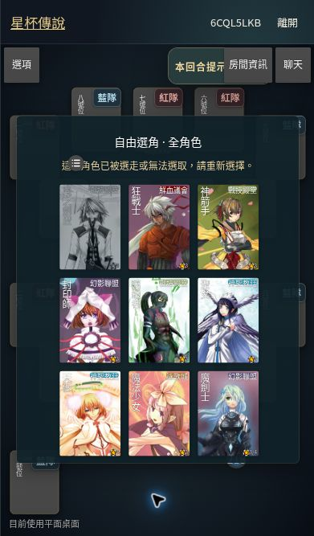

# 多人自由選角與同場唯一角色

沿用固定版無名杯的 chooseButton、wait、sandbox、廣播及戰鬥事件。4／6／8 人房統一從完整已啟用角色池選擇；房主按確認抵達順序保留角色家族。後到的衝突結果不解除原生等待，客端重新選擇。電腦只能使用剩餘角色。

## 已完成的正式站驗證

`8b9495762d5de3703af9e91f2f039d66a84914bc`，八人房 `6CQL5LKB`，兩位真人分頁、六位 AI：

- 桌面與 390×667、實際載入 phone.css 的手機樣式皆顯示 67 個原生可開局角色選項。圖鑑另含轉換形態；未改動上游角色可用性判斷。
- 兩人先選風之劍聖，再同時按確定。房主保留角色；客端顯示「這名角色已被選走或無法選取，請重新選擇」，原角色灰階、aria-disabled=true。
- 八個座位的最終角色皆不同，兩端一致，並進入原生戰鬥。角色為風之劍聖、魔槍、聖槍騎士、魔法少女、貪婪少女、噬神者、靈符師及勇者。
- 本次測試房與先前的四人驗收房 `TPYL6XYP` 已關閉。
- 客端缺少模式方法的問題已修復：在握手前安裝共用選角方法，涵蓋初次加入與重連。

## 此次追加修正與測試邊界

實玩發現原生 Client.close 會在選角途中斷線時立即隨機代選。追加修正保留既有選角等待與倒數，允許期限內重連；逾時仍用原生 AI。回歸直接執行產生的 native server.result 與 Client.close，涵蓋搶角順序、過期／重複結果、斷線、重連及 4／6／8 人 AI 補位。

此次是選角及開局驗證，並非十場完整對局或大量玩家壓力測試。手機驗證使用 Chromium 手機樣式與尺寸，非實體 iOS。完整牌局仍由房主瀏覽器主持；HTTP 輪詢尚未改成 Cloudflare WebSocket。
