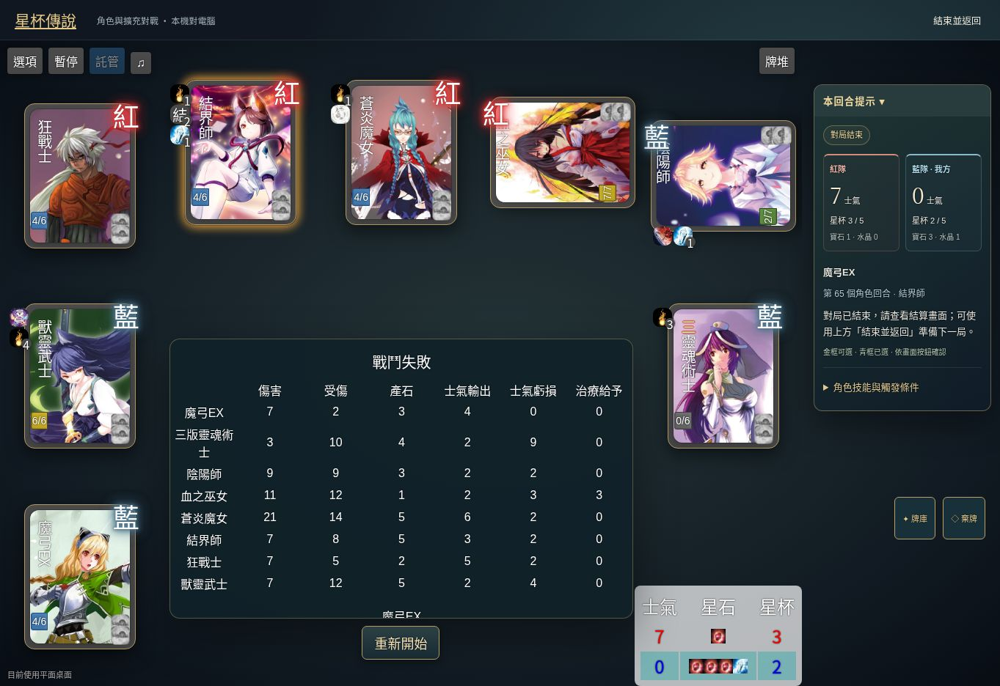

# 手機啟動、繁體中文與完整對局驗收

使用者回報 iPhone 停在觸屏確認視窗，並要求全站繁體中文、實際測試 10 場及同場角色不得重複。這次沿用原始無名杯引擎，未重寫角色技能或改成 Codify 後端。

共完成 **11 場完整對局**，其中第 6 場找到魔弓 EX 重複，修正後第 11 場重測完成；其餘 10 場的公開角色名單無重複。這是邊玩邊修的紀錄，不代表最初版本的 11 場皆無缺陷。公開結算資料保存於 [JSON](qa-full-match-results-2026-10-25.json)。

## 修正

- `grail-config.js` 每次覆寫設定時漏掉 `totouched`，原引擎按下確認會儲存旗標並 reload，下一次又被清除。現在啟動前在兩層設定寫入旗標，依主要指標類型選觸控／滑鼠，無須阻塞式詢問或重新載入。
- 建置時以固定版本 opencc-js 轉換 59 個引擎檔案、7,931 個語言 token。選項顯示與相應字串比較一併轉換，保留路徑、連結、技能代碼、數值及控制流程；沒有在玩家操作後用 DOM 轉換器改按鈕文字。首頁、教學、圖鑑、設定及遊戲字串皆改繁體，保留正式名稱「染污者」「游擊士」。
- 沿用上游選角流程，每次選定後排除同角色的所有三／四版及替代形態。多選時的 filterButton 同樣檢查角色家族。第 6 場找到魔弓 EX 的遺漏，另補上魔弓與魔弓 EX 的互斥。
- 第 2 場發現敗方士氣顯示 -1；HUD 與原士氣表現在最低顯示 0，未改引擎內部損失量、統計及勝負判定。
- 手機尺寸實玩後，補大頂部選項、暫停、託管及牌堆按鈕至至少 44 像素，保留原引擎縮放與點擊座標換算。
- 手機尺寸搭配滑鼠時，上游懸停快速選單可能攔截「選項」點擊造成重開，已關閉該懸停選單；放大工具列後，一般設定選單也須向下移，避免遮住工具列而無法直接點同一按鈕關閉。保留點擊式設定、託管與原遊戲流程。

## 方法與範圍

使用正式網域的真實瀏覽器頁面操作選角、確認、手牌及目標；第 1、4 場包含手動出牌，第 1 場亦操作技能回應。其餘回合使用遊戲內建託管及「很快」速度，觀察到「對局結束」和每名角色的結算統計才記為完整場次。沒有從瀏覽器注入引擎指令、跳過回合或寫入遊戲狀態。

手機版面使用同站 390×844 iframe 檢查，並非實體 iPhone／Safari 測試。啟動回歸執行實際發佈的首次觸控分支，涵蓋 iPhone、Android、iPad 桌面 UA、觸控筆電及一般桌機，各重複啟動三次，確認沒有 confirm 或 reload。雲端環境不支援 WebGL，使用既有平面備援；這不等於實機 3D 效能驗證。

## 對局紀錄

「回合」為畫面顯示的角色回合數；士氣與星杯均依紅／藍順序。第 6 場完整結束，但發現 EX 重複選角，於第 11 場選用魔弓 EX 重測；不能把第 6 場記成角色唯一檢查通過。啟動及選單誤觸後未結束的試跑不列入完整場次。

| 場次 | 人數／版本 | 操作角色 | 回合 | 最終士氣 | 最終星杯 | 結果／發現 |
| --- | --- | --- | --- | --- | --- | --- |
| 1 | 4／現行 | 記錄者 | 73 | 8／3 | 5／1 | 紅勝，星杯達標；角色無重複 |
| 2 | 6／現行 | 女武神 | 92 | -1／9 | 3／1 | 藍勝；負士氣顯示問題已修 |
| 3 | 8／現行 | 天使 | 82 | 0／5 | 4／4 | 藍勝；角色無重複 |
| 4 | 4／現行，手機尺寸 | 封印師 | 55 | 9／0 | 2／0 | 紅勝；手動出牌成功，士氣顯示已修 |
| 5 | 6／現行 | 蝶舞者 | 74 | 6／0 | 1／0 | 紅勝；角色無重複 |
| 6 | 8／含舊版 | 三版風之劍聖 | 34 | 18／0 | 1／0 | 紅勝；魔弓與魔弓 EX 同場，修正並重測 |
| 7 | 4／現行，手機尺寸 | 聖仲裁者 | 49 | 0／5 | 2／2 | 藍勝；角色無重複，劍之子依原技能變為風之劍聖 |
| 8 | 6／含舊版 | 四版魔法少女 | 49 | 5／0 | 2／0 | 紅勝；自由選角與舊版排除正常 |
| 9 | 8／現行 | 蒼炎魔女 | 79 | 7／0 | 2／2 | 紅勝；角色無重複 |
| 10 | 4／現行，手機尺寸 | 神秘學者 | 83 | 0／3 | 3／1 | 藍勝；設定選單遮住工具列的問題另補 CSS 修正 |
| 11 | 8／含舊版 | 魔弓 EX | 65 | 7／0 | 3／2 | 紅勝；EX 重測完成，未出現魔弓同場 |

前 3 場版本 `65737dd`；第 4–6 場 `b207cc6`；第 7–9 場 `3ad97d6`；第 10–11 場 `cdf43fc`。第 7 場保持預設「中」速度，其餘完成場次使用「很快」。

最後的 CSS 修正 `21eafc0` 已在正式站另開 390×844 頁面驗證：工具列按鈕至少 44×44px，選單在工具列下方；成功開啟設定、由「中」改為「很快」、點原「選項」關閉，再選取劍之魔女並出現確認。此額外操作檢查未結束對局，不計入上述 11 場。

### 公開角色名單

1. 記錄者、冒險家、染污者、格鬥家。
2. 女武神、格鬥家、風之劍聖、怠惰少女、見習製片、陰陽師。
3. 天使、聖殿騎士、神官、游擊士、染污者、神箭手、靈符師、見習製片。
4. 封印師、瘟疫法師、神箭手、原初之弓。
5. 蝶舞者、咒符師、月之女神、爆食少女、瘟疫法師、聖槍騎士。
6. 三版風之劍聖、四版魔劍士、神秘學者、魔弓 EX、三版吟遊詩人、魔弓、原初之弓、游擊士。
7. 聖仲裁者、血之巫女、蘿莉番長、風之劍聖（初始為劍之子，依原技能轉換）。
8. 四版魔法少女、鑄律者（初始為紅衣主教）、陰陽師、聖庭檢察士、原初之弓、暗殺者。
9. 蒼炎魔女、記錄者、靈魂術士、神官、聖弓、靈熙之潮、噬神者、女僕長。
10. 神秘學者、異教徒、爆食少女、祈禱師。
11. 魔弓 EX、三版靈魂術士、陰陽師、血之巫女、蒼炎魔女、結界師、狂戰士、獸靈武士。

名單以公開結算角色為準；選角唯一限制不重寫對局中的合法角色轉換技能。

## 自動回歸

`npm test` 30 項、`npm run test:engine` 32 項、`npm run typecheck` 通過。新增回歸涵蓋真實啟動分支、繁體選項對技能分支的影響、公開圖鑑文字、資源路徑不變，以及 4／6／8 人的實際上游選角步驟（含自由選角、舊版與 EX）。角色唯一限制目前針對完整擴充的實際角色選角；簡化核心多人中的圖片仍是教學參考頭像。

11 個對局分頁的錯誤紀錄未見遊戲程式例外；可見雲端瀏覽器不提供 WebGL 的既有備援訊息，以及瀏覽器擴充功能自身的 metadata 錯誤。這些未冒稱為「所有 console 訊息皆為零」。

本輪不代表 68 位角色的所有互動技能均已按官方 FAQ 驗收，也未新增完整擴充跨裝置多人功能。
