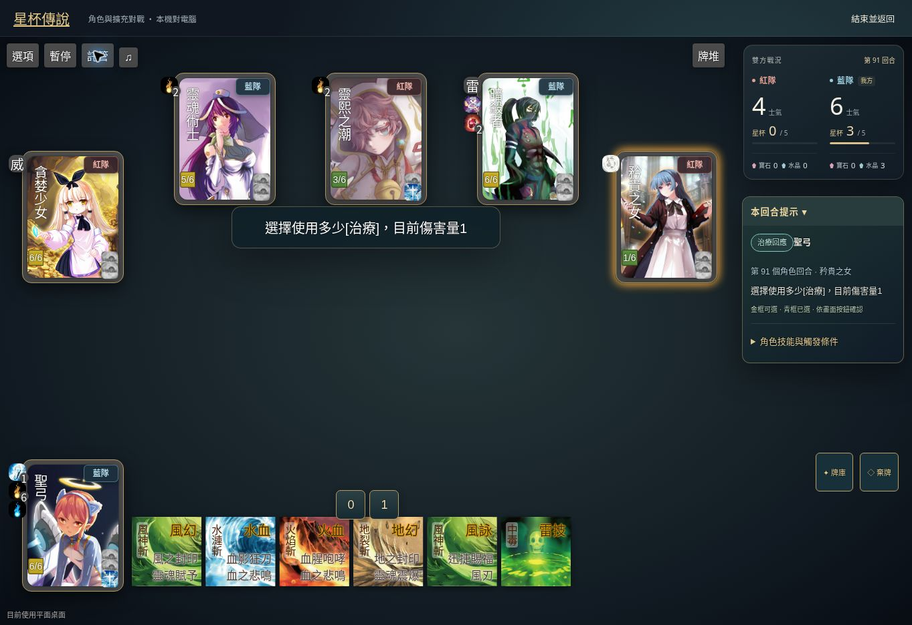
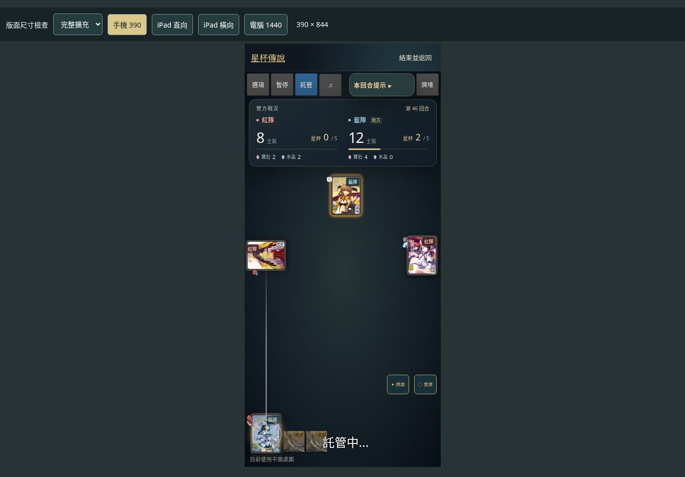

# 紅藍隊徽章與戰況計分板美化

使用者指出角色旁紅藍隊文字及士氣／星杯區域不美觀。本輪沿用原引擎資料與選角限制，只更新顯示層。

- 角色上的大字與霓虹光暈改成小型圓角徽章，紅隊使用柔和珊瑚色，藍隊使用霧藍色；保留文字區分及原角色操作。
- 原本提示框中的分數與右下角舊表格整合成獨立戰況板。士氣用大數字、星杯以數字及金色進度條顯示，寶石與水晶各有標籤及小圖示；標示我方隊伍。
- 桌面計分板在右側；手機／平板雙隊並排放在工具列下方，提示可單獨收合。牌桌保留原縮放與座標換算，讓出計分板空間。
- 只有新計分板取得對局資料後才隱藏原表格。`teamSummary` 仍是公開數值的唯讀轉接，未修改士氣、資源、星杯與勝負規則。
- 實測發現上游樣式讓空進度條收成零寬，補上 block 與 100% 寬；平板提示框收合時明確清除 bottom 並限制高度。

## 驗證

- `npm run prepare:engine`、32 項 `npm run test:engine`、兩個顯示模組語法檢查及 `git diff --check` 通過；本輪未修改核心規則或 Next.js 元件。
- 正式站四人手機牌局：選戰鬥法師，手動選風神斬 → 祈禱師 → 確定，手牌由 4 張變 3 張，出牌與選目標正常；之後用內建託管觀察分數變化。
- 正式站六人桌面牌局：選魔劍士，觀察紅隊星杯 0 → 1、士氣與寶石／水晶隨回合更新。我方標記與角色隊伍徽章相符。
- 手機 390×844 的計分板寬 374px、位於 x=8，無水平溢出；平板 768px 時計分板寬 480px。此為瀏覽器尺寸驗證，不是實體 iPhone／iPad 測試。

- 最終修正版重新開局驗證：桌面星杯 3 / 5 時，進度條寬 98px、填色 58.8px（60%）；手機計分板 clientWidth 與 scrollWidth 同為 372px。平板收合提示框約 130×46px，不再佔據整個右側。
- 功能提交 `071965b9e3ce15e49f8a3712f036458da13da7a2`；Vercel 部署 `dpl_AcdkJKNL3L2hSdZ2hwPFeCR5Zrvr` 已 READY，原 Production alias 已生效。後續文件與截圖提交不更動遊戲程式。
- 本輪是顯示與互動回歸；先前 11 場完整對局紀錄仍見 [實玩報告](qa-mobile-zh-hant-2026-10-25.md)，沒有將本輪部分牌局重算為完整場次。

## 正式站截圖

桌面六人牌局，第 91 個角色回合：

手機 390×844，同站尺寸檢查：

