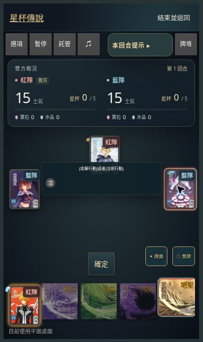
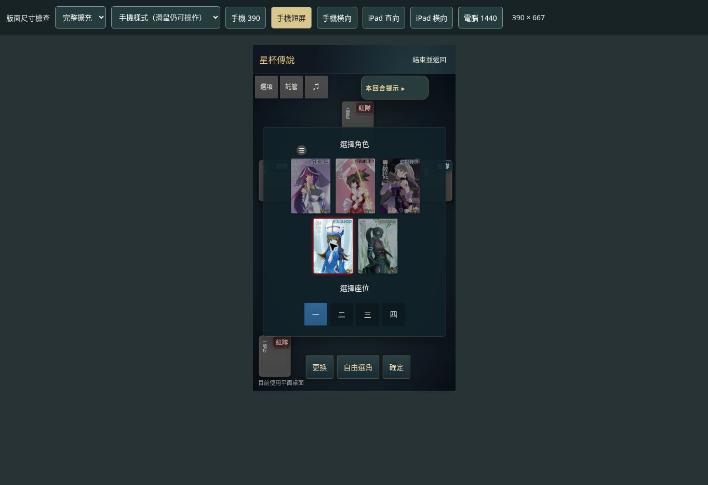
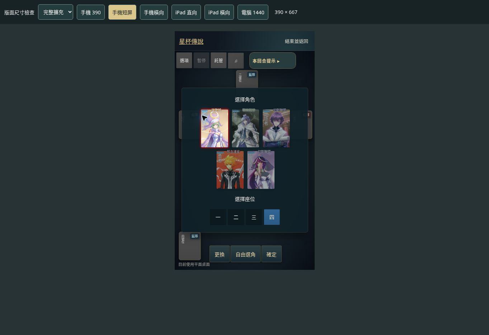

# 目前部署狀態

> 2026-10-26 最新接手與發布狀態見 [長離線重連與紀錄接手](guest-rejoin-history-handoff.md)。正式 Cloudflare 分支仍為 `43c101b2ba900880d41072f427ffbcd1cc6bc26f`，本輪 218 項測試及 64 項 HTTP 檢查通過的修改尚未部署，Vercel 保留。以下為歷史紀錄。

更新日期：2026-10-25（UTC 2026-10-24）。歷史十局紀錄另見 game-test-report-2026-10-25.md；先前功能驗證見 [完整擴充實玩報告](qa-mobile-zh-hant-2026-10-25.md)。

## 最新：手機手牌放大

- 600px 以下手牌由實測 41.6×41.6px 放大為 72×72px，牌面文字同步放大，採橫向捲動並保留原卡牌節點與點擊事件。選取抬升 8px，控制列與手牌留空。
- 手機停用原 fan（fold_card=false），保留引擎 scrollh 觸控捲動路徑；覆寫 nova 高優先級的手牌寬度與捲動列 top:60px，避免牌面裁切。
- 功能提交 `17b2b3180106ad8edef36de9f4c2cf98a1a0a2ad`，Production `dpl_7NEx41jdfWvh7YC3AFfFGae4vdLw` READY，原 alias 生效。33 項引擎測試與 diff 檢查通過。
- 390×844 驗證放大手牌的選牌／目標／出牌；最終版 390×667 手機 CSS 驗證原生 scrollh、306.3px 手牌容器、72px 牌面、末張捲動可見、8px 選取抬升，勇者打出地裂斬後手牌 4→3。Chromium 樣式驗證，非實體 Safari。
- 開局預設 5 選 1 為正常設定；「自由選角」可切換全部目前版本可用角色，本輪沒有更改選角規則。

## 前次：修正 phone.css 的工具列與按鈕裁切

使用者第二張實機截圖證實前次只改善了選角面板，頂部與底部按鈕仍裁切。查明桌面瀏覽器即使縮至 390px，`pointer: coarse` 仍為 false，因此前次測試沒有載入真正的 `layout/default/phone.css`。

- 上游手機樣式將 `#control > div` 外框固定 40 個引擎邏輯 px，內層則被我們放大到 44 個視窗 px；搭配 overflow:hidden，造成按鈕文字被切掉。新覆寫清除外框固定高度，內外尺寸一致並避免裁切。
- 上游 `#system > div:not(.shown)` 向上平移 80px 並停用其子項點擊。新覆寫保留可見工具列、恢復點擊與暫停／託管，移除不再需要的浮動展開按鈕；設定面板起點置於工具列下方。
- `grail-phone-layout` 由實際輸入設定決定；所有原按鈕節點、事件處理、遊戲規則與 body 縮放保留。
- 尺寸 QA 新增「手機樣式」選擇，明確傳遞 `phone-layout=1` 載入手機 CSS，同時保留滑鼠操作。後續不能把「縮小桌面」當作手機專用樣式已驗證。
- prepare:engine、33 項引擎測試、typecheck、diff 檢查通過。新增桌面載入手機樣式但保留滑鼠的啟動回歸。實體 iOS Safari 仍需區別於桌面尺寸或樣式模擬，不得宣稱已實機驗收。
- 功能提交 `5851c4aaa81ae0b75be4cb0ab3873126e998832b`，Production `dpl_A1viGgHDDC6LUWCC5a3QcyJDXQzK` READY。登入正式站後確認同時載入原生 `phone.css` 與新覆寫；390×844、390×667 工具列 44px 高，底部外框約 44.8px、內容 44px，文字完整。實際更換角色、開關設定、神官選角確認開局；8 人短屏另驗自由選角開關、第八座位與確認按鈕。詳細記錄見 [手機樣式驗證](qa-native-phone-controls-2026-10-25.md)。

## 前次：網站密碼入口與手機選角修正

- 全站共用密碼入口，驗證資料僅存 Vercel Production sensitive 環境變數；首頁、引擎直連、JSON、圖片及遊戲 API 均驗證伺服器簽章 cookie。7 天到期，可在 `/access` 重新鎖定。設定與測試見 [網站入口](site-access.md)。
- 手機選角改成置中且可捲動的面板，角色候選換行，座位 44×44px，控制列獨立留空；選角時隱藏裝飾牌堆。外層遊戲改用固定可視高度，消除 `min-height:100vh` 大於 Safari `100dvh` 的衝突，原引擎縮放與座標保留。
- 正式站版面修正 `ebb3b8000dd760b6977b3b1acedd5e6d58d2cd24` 已驗證：390×844、390×667、844×390；選祈禱師、切第四座位後確定開局。短屏面板底部約 507px、控制列頂部 544px，兩者不重疊；橫向內容可獨立捲動。這是 Chromium 尺寸檢查，不是實體 iOS Safari 測試。
- 37 項核心／入口單元測試、32 項引擎測試、typecheck 與獨立路由整合測試通過。正式站 37 項 HTTP 驗證通過，涵蓋錯誤／正確密碼、簽章 Cookie、未登入頁面／API／引擎／圖片轉換攔截、私有快取、重新鎖定與外站回跳。功能提交 `695ffa0b2d3bf5fa3a0bb86fb91e700fa74058ce`，Vercel `dpl_G7AbvviiiXYLHKdSHDhimwN7BHs9` READY，原 alias 已生效。結果不含密碼或 cookie。本機 Next dev 因宿主 `uv_resident_set_memory` 無法服務，正式建置以 Vercel 結果為準。

## 前次：紅藍隊徽章與戰況計分板美化

- 角色隊伍文字改成珊瑚紅／霧藍色小型徽章；獨立戰況板呈現大字士氣、星杯數字與金色進度條、寶石／水晶及我方標記。
- 桌面右側顯示，手機／平板雙隊並排置於頂部；提示可獨立收合。保留原引擎縮放、選角唯一限制與所有規則。
- 最終功能提交 `071965b9e3ce15e49f8a3712f036458da13da7a2`，Vercel `dpl_AcdkJKNL3L2hSdZ2hwPFeCR5Zrvr` 已 READY 且原網域生效。後續文件提交不改程式。
- 32 項引擎測試、prepare:engine、語法與 diff 檢查通過。正式站手動出牌、分數更新及桌面／390px 手機／768px 平板尺寸回歸完成；截圖及限制見 [美化驗收](qa-scoreboard-2026-10-25.md)。不是實體 iOS 裝置測試。

## 前次：手機啟動、繁體中文與選角唯一

- 保留無名杯實際引擎及 Codify 架構對照；未重寫技能引擎或新增 C++ 後端。
- 修正每次載入覆寫首次觸控旗標導致的確認／reload 循環，依主要指標類型初始化輸入模式。
- 全站可見文字與正式引擎建置內容繁體化；固定 opencc-js 1.4.2，7,931 個 token／59 檔。選項與判斷字串同步轉換，保留原資源 URL、技能代碼及數值。
- 原始選角流程增加角色家族排除，含舊版、紅衣主教／鑄律者及魔弓／魔弓 EX。保留遊戲中的合法轉換技能。
- 修正士氣負值顯示、放大手機工具列、關閉懸停快速選單，將一般設定選單移至工具列下方。390×844 實測頂部按鈕至少 44×44px，設定可開啟、改速度、關閉後回到選角。
- 最新功能提交 `21eafc0f10e0bc52f8571e7e1fce88a38a7cf968`；Vercel `dpl_7uTFdiA6UTdyE88jb4vA6B36NQWn` READY，Production alias 保持 https://star-grail-online.vercel.app/ 。後續文件提交不變更遊戲程式。
- 驗證：30 項核心、32 項引擎測試及 typecheck 通過。完整擴充實跑 11 場、735 個角色回合，實玩與重測資料見 [完整擴充 QA](qa-mobile-zh-hant-2026-10-25.md)，手動操作搭配原引擎託管，包含 4／6／8 人及舊版角色。
- 手機測試為瀏覽器尺寸模擬，未實測 iPhone Safari 或硬體 WebGL；未宣稱全 68 位角色交互裁定已驗收。完整擴充仍是本機對電腦。

## 上一輪：沿用上游引擎的介面更新

- 開發依據與分工見 [架構說明](architecture.md)：無名杯仍是實際規則引擎，Codify 作為狀態機／隊伍資源對照，未重寫引擎或部署 C++ 伺服器。
- 最新功能提交：`1d44250b724d3ca26628e1b184c237c37ade505a`（包含 `8dc5608` 介面更新及 `03ed372` 版面修正）。Vercel 正式部署 `dpl_31mFMu9Y2VUVGcGUXEGuceAsuGYw` 已 READY，Git source 為 main，原正式網域已指向此版本。
- 首頁主要入口改為角色與擴充對戰；保留核心多人房間。選局介面、角色卡展示、公開戰況與行動／回應提示、可選／已選輪廓已更新。
- 修正未定義字型變數、手機 iframe 高度、原引擎 arena 超界和 focus 導致的隱藏容器捲動。保留原本 body 縮放與點擊座標系；手機控制按鈕依縮放補償後實測為 44px 高。
- 30 項核心測試、19 項引擎／顯示測試、TypeScript 與 diff 檢查通過。本機 build 受宿主 `uv_resident_set_memory` 不可用影響，正式 Next.js build 已由 Vercel 成功完成。
- 瀏覽器實際檢查：首頁入口、角色圖鑑直達、4／6／8 人設定、選角與座位、出牌選目標、傷害抽牌、隊伍戰績更新；桌面 1470×681 與手機 390×844。最終版手機選角確認後 arena 及所有四個角色均在視窗內，容器 scrollLeft／scrollTop 為 0。
- 此次為操作與版面回歸，不是全角色裁定驗收，也不是實體手機測試。完整擴充仍為本機對 AI，跨裝置多人尚未接入。

以下保留上一輪發布紀錄，非最新功能版本。

- 網站：https://star-grail-online.vercel.app/；完整擴充入口 `/full`。
- 完整原始碼及 19 張專案圖片已同步到 https://github.com/virus11456/starcup 的 main。引擎素材在建置時依固定版本重新產生；秘密、依賴及建置產物不提交。
- 功能版本 GitHub main：`6cd2e83334f5afd133758820c65484afe08a91fe`；本報告的提交只更新文件。
- Vercel 正式部署：`dpl_HM7yaFwNrV9mskhNhwggMK8jWi8t`，原功能版本透過 MCP files 部署。既有專案現已連到 GitHub `virus11456/starcup`，Production 追蹤 `main`。已驗證 GitHub main 提交 a7fb82d8711aaa50390cca19ca50e0de097dcc60 自動觸發部署 dpl_2fAVNk8GRCwv5f53A16vJZe2GHJd；來源為 git，狀態 READY，原正式網域已指向該部署。
- Supabase 已提供核心版房間儲存與多人 API；後端設定已放在 Vercel Production，RLS 阻止瀏覽器直接讀取房間狀態。

## 已更新

- 品牌統一「星杯傳說」，修復首頁頂部導覽被擠到左欄與手機裝飾溢出。
- `/cards` 與 `/full` 共用逐張 150 張圖鑑，附屬性、派系、獨有技標記、牌型效果、搜尋篩選與表格。11 種牌型和 150 張實體牌分開標示。
- 百科為規則主要參考，保存 6 類指南、11 種牌型及 68 個角色頁連結；核心新局牌庫數量與應戰目標依百科修正。
- 抽牌、出牌、放置效果牌、棄牌四種動畫；Three.js 及無 WebGL 備援。完整引擎增加 body 縮放補償，避免手機動畫座標漂移。
- 正式站核心 10 局、1,016 個合法操作及 78 項多人整合檢查通過；完整擴充瀏覽器實玩一局至第 62 個角色回合正常結算。詳見測試報告。

## 尚未完成

- 完整擴充跨裝置多人、68 位角色全部交互技能逐項核對。
- 硬體 WebGL 視覺驗證、上游完整設定選單的手機可讀性改善及實體裝置驗證。
- 高清印刷牌面：目前使用上游角色素材與牌型插畫。

## 重跑檢查

`npm test`、`npm run typecheck`、`npm run prepare:engine`、`npm run test:engine`。

正式站使用 `GRAIL_TEST_URL=https://star-grail-online.vercel.app node scripts/check-live-matches.mjs` 跑十局；`scripts/check-multiplayer.mjs` 跑獨立會話整合。測試建立私密房，不能清空其他房間。報告不含 Cookie、手牌或金鑰。
