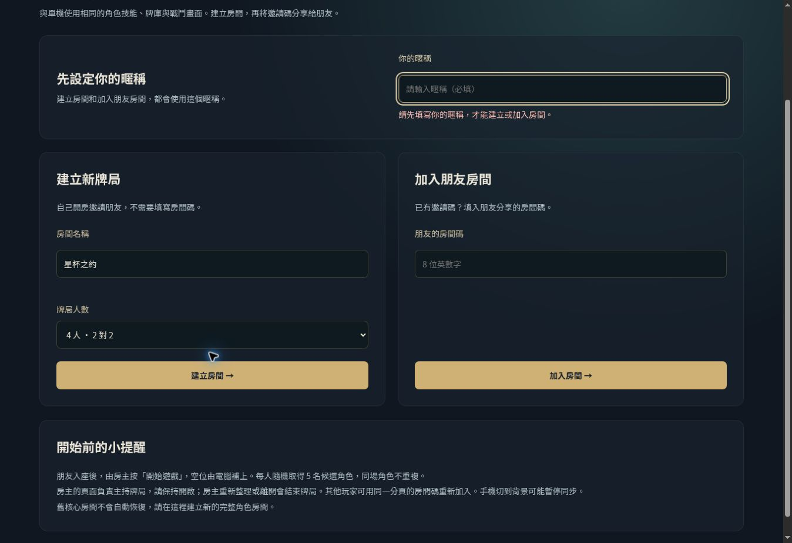

# 建立房間表單修正驗收

使用者截圖中的暱稱空白，舊介面把共用暱稱放在「準備加入」面板，卻同時停用「建立房間」，沒有說明原因。

本次將暱稱放在建立／加入上方，並加入漏填提示與欄位自動聚焦。建立房間不需填邀請碼；按鈕只有在送出請求期間才停用。加入房間碼、房名仍有表單及既有伺服器驗證。

正式站版本：`b468b9c067c6205c494c769ade68bb18ee4deafd`，Vercel READY。

- `npm run typecheck` 與 `git diff --check` 通過。
- 桌面：清空暱稱後點建立，顯示「請先填寫你的暱稱，才能建立或加入房間。」並聚焦暱稱；未誤建房間。
- 桌面：補上暱稱，房間碼留空，成功建立 `55GKF3G8`，顯示房主與「開始遊戲」。
- 手機 390 × 667：共用暱稱為單欄，漏填時能從加入表單定位回暱稱；補填後成功加入同一房間，房內同時顯示房主與手機玩家。
- 此次只調整表單呈現及前端驗證，未改遊戲規則或房間服務。

