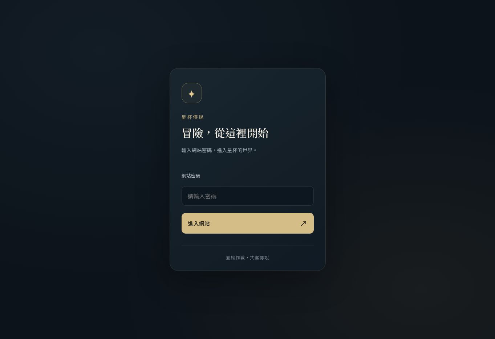

# 網站密碼入口

網站使用共用密碼入口。密碼只放在原 Vercel 專案的 Production sensitive 環境變數，程式庫、前端 bundle 與測試報告不保存正式密碼。

- `SITE_ACCESS_PASSWORD`：共用入口密碼。
- `SITE_ACCESS_SESSION_SECRET`：32 隨機 bytes 的 64 位小寫 hex 字串，簽署登入 cookie。
- 缺任一設定即保持鎖定；其他環境需另設密碼及獨立金鑰。
- 成功登入保存 7 天的 HttpOnly／Secure（正式環境）／SameSite=Lax cookie。更換密碼或簽署金鑰並重新部署會使舊憑證失效。
- `/access` 可重新鎖定目前瀏覽器。共用密碼不是個人帳號，也不會改變遊戲原有玩家識別 cookie。

`proxy.ts` 驗證全部頁面、RSC 請求、API、引擎 HTML／JS／圖片及圖鑑 JSON；只有 `/access`、`/api/access`、Next.js 編譯的 JS／CSS 與網站圖示公開。`/api/game` 本身也驗證 cookie，避免只依賴 Proxy。

登入使用同源 POST，限制本文大小，阻擋外站回跳；驗證密碼與簽章使用固定長度摘要的 timing-safe 比較。回應禁止共用快取。連續嘗試限制為每個伺服器執行個體、每來源 IP 15 分鐘 10 次，屬於基本防護，並非跨區域全域限流。

## 驗證

- `npm test`：包含密碼、偽造／到期憑證、金鑰與密碼輪替、缺設定及外站回跳檢查。
- `node --experimental-strip-types scripts/test-site-access-routes.mjs`：直接執行 Proxy、登入和遊戲 API handler，涵蓋未登入攔截、正確／錯誤密碼、Cookie、跨站請求、過大本文、嘗試限制與缺設定。只用測試值。
- `scripts/check-site-access.mjs`：以 HTTP 檢查實際部署，透過 `ACCESS_TEST_URL` 與 `ACCESS_TEST_PASSWORD` 傳入；不記錄密碼、Cookie、完整回應或環境變數內容。勿把正式密碼寫進命令紀錄或報告。

手機修正保留原引擎 body 縮放及點擊座標；固定外層遊戲於可視高度，選角面板置中、內容獨立捲動，角色候選卡片換行，座位按鈕為 44px，底部控制列獨立保留空間。選角時隱藏裝飾用牌庫／棄牌堆。

## 正式站驗收結果

功能提交 `695ffa0b2d3bf5fa3a0bb86fb91e700fa74058ce`，Vercel `dpl_G7AbvviiiXYLHKdSHDhimwN7BHs9` READY，原正式網域已生效。37 項 HTTP 檢查通過：登入前頁面、API、引擎 HTML／JS、圖鑑 JSON 及受保護圖片的轉換入口皆不能取得內容；正確密碼後 `/full`、引擎、圖鑑及遊戲 API 回傳 200，且回應不允許公開快取。錯誤密碼與跨網站登入不發憑證，外站回跳被拒絕，重新鎖定會清除 Cookie。瀏覽器開啟 `/full` 也確認轉到密碼入口。

測試時 Vercel 的 Location 使用相對路徑，HTTP 檢查已兼容；圖片檢查使用受保護的實際角色 JPG，公開 favicon.svg 不屬於受保護內容。之後的提交只更新驗收文件與測試工具。

